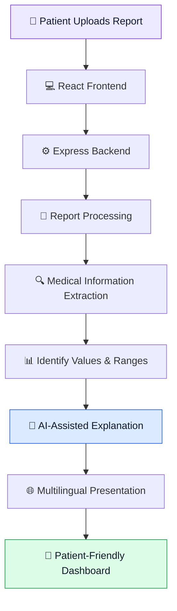
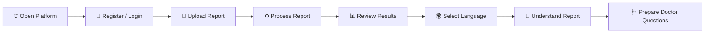

# 🏥 MED-DECODER
### AI-POWERED VERNACULAR HEALTHCARE INTELLIGENCE PLATFORM
**"अब मेडिकल रिपोर्ट पढ़ना होगा आसान!"**  
> *Empowering patients across India to understand complex medical reports in simple Hindi, Marathi, and English.*

<p align="center">
  
</p>

<p align="center">
  <strong>Making Medical Reports Understandable for Everyone.</strong>
  <br />
  <em>Breaking Language Barriers. Simplifying Healthcare. Empowering Patients.</em>
</p>

<p align="center">
  
  
</p>

<p align="center">
  
  
  
  
  
</p>

<p align="center">
  <a href="https://med-decoder-i14o.onrender.com/">
    
  </a>
  <a href="https://github.com/mohammadjubaid76-collab/Med_Decoder">
    
  </a>
</p>

---

# ✨ THE IDEA

**What if every patient could understand their medical report without struggling with complicated medical terminology?**

Med-Decoder is an AI-powered healthcare report simplification platform designed to make complex medical laboratory reports easier to understand.

It aims to bridge the gap between medical information and everyday understanding through simplified explanations, multilingual support, and structured health information.

Our vision is simple:

> Healthcare information should be understandable to everyone, regardless of their language or technical knowledge.

---

# 🌐 01. LIVE APPLICATION

<details>
<summary><strong>Explore the Med-Decoder platform</strong></summary>

| Resource | Link |
|---|---|
| 🌐 Live Website | [Open Med-Decoder](https://med-decoder-i14o.onrender.com/) |
| 🔐 Patient Login | [Login Portal](https://med-decoder-i14o.onrender.com/login) |
| 💻 GitHub Repository | [View Source Code](https://github.com/mohammadjubaid76-collab/Med_Decoder) |

**Deployment Platform:** Render

</details>

---

# 🚨 02. THE PROBLEM

## Medical reports are available. But are they understandable?

Many patients receive laboratory reports containing technical terms, numerical values, abbreviations, and clinical reference ranges.

Understanding these reports can be challenging, especially for people who are not familiar with medical terminology.

### Key Challenges

| Challenge | Why It Matters |
|---|---|
| 🧬 Complex Medical Terminology | Patients may not understand technical medical words. |
| 🌍 Language Barriers | Medical information may not be available in a familiar language. |
| 📊 Reference Range Confusion | Normal, High, Low, and Borderline values can be difficult to interpret. |
| 💊 Prescription Readability | Handwritten prescriptions can be difficult to read. |
| 🩺 Limited Health Literacy | Patients may not know which questions to ask their doctors. |

**The Core Problem:** Access to medical information does not always mean understanding medical information.

---

# 💡 03. OUR SOLUTION

## Introducing Med-Decoder

Med-Decoder aims to transform complex medical information into simple, structured, and multilingual explanations.

### How We Help

- 📄 Upload supported laboratory reports.
- 🔍 Extract and organize report information.
- 🧠 Simplify complex medical terminology.
- 📊 Present clinical reference-range indicators.
- 🌐 Provide multilingual explanations.
- 💊 Support handwritten prescription interpretation.
- 🩺 Generate suggested questions for doctor consultations.

### Our Language Approach

| Language | Availability |
|---|---|
| English | Supported |
| Hindi | समर्थित |
| Marathi | समर्थित |

---

# ⚡ 04. PLATFORM FEATURES

| Feature | Description |
|---|---|
| 📄 **Report Upload** | Upload supported laboratory report documents and images. |
| 🧠 **Report Decoder** | Simplify complex medical information. |
| 🌐 **Multilingual Support** | English, Hindi, and Marathi explanations. |
| 📊 **Clinical Indicators** | Display Normal, High, Low, and Borderline statuses. |
| 💊 **Prescription Decoder** | Support interpretation of handwritten prescriptions. |
| 🩺 **Doctor Question Assistant** | Generate three suggested questions for doctor consultations. |
| 📚 **Report History** | Access previously decoded reports. |
| 🔐 **Authentication** | Firebase-based authentication and role-aware access. |
| 📱 **Responsive Dashboard** | Modern healthcare dashboard interface. |
| 🔔 **Notifications** | User-friendly notification and toast messages. |

---

# 🧠 05. AI INTELLIGENCE & WORKFLOW

Med-Decoder is designed around an AI-oriented medical report interpretation workflow.

### Report Processing Pipeline



### Intelligence Capabilities

- Medical terminology simplification.
- Interpretation of structured laboratory values.
- Clinical reference-range status presentation.
- Multilingual explanation generation.
- Handwritten prescription interpretation.
- Contextual questions for doctor consultations.

### AI Technology

**Google Gemini API**

The backend is designed to integrate Google's Gemini API for AI-powered processing.

<sub>Current deployment status: Gemini API is not yet configured on the live deployment. A valid server-side API key is required to enable Gemini functionality.</sub>

---

# 🏗️ 06. SYSTEM ARCHITECTURE

Med-Decoder follows a modular frontend-backend architecture.


### Architecture Breakdown

| Layer | Technology | Responsibility |
|---|---|---|
| Frontend | React 19 | User interface and dashboard |
| Programming Language | TypeScript | Application logic and type safety |
| Build Tool | Vite | Development and production builds |
| Styling | Tailwind CSS v4 | Responsive design |
| Backend | Node.js + Express | API handling and server logic |
| AI Integration | Google Gemini API | AI-powered interpretation |
| Authentication | Firebase | Authentication and administration |
| Deployment | Render | Application hosting |
| Version Control | GitHub | Source code management |

---

# 📁 07. PROJECT STRUCTURE

```text
Med_Decoder/
│
├── index.html
├── metadata.json
├── package.json
├── package-lock.json
├── vite.config.ts
├── server.ts
├── .env.example
├── .gitignore
├── README.md
├── firebase-applet-config.json
├── firestore.rules
│
├── scripts/
│   └── set-admin.ts
│
├── public/
│   └── assets/
│       └── build-the-ai-for-you-logo.png
│
├── data/
│   └── lab_report_interpretation_sft.csv
│
└── src/
    ├── main.tsx
    ├── App.tsx
    ├── index.css
    │
    ├── types/
    │   └── index.ts
    │
    ├── translations/
    │   └── index.ts
    │
    ├── services/
    │   └── api.ts
    │
    ├── data/
    │   ├── sampleReports.ts
    │   └── samplePrescriptions.ts
    │
    ├── context/
    │   └── AppContext.tsx
    │
    ├── layouts/
    │   ├── PublicLayout.tsx
    │   └── DashboardLayout.tsx
    │
    ├── components/
    │   ├── common/
    │   ├── dashboard/
    │   ├── report/
    │   └── prescription/
    │
    └── pages/
        ├── LandingPage.tsx
        ├── DashboardPage.tsx
        ├── UploadReportPage.tsx
        ├── ReportAnalysisPage.tsx
        ├── PrescriptionDecoderPage.tsx
        ├── MyReportsPage.tsx
        ├── HowItWorksPage.tsx
        ├── AboutPage.tsx
        ├── SettingsPage.tsx
        └── HelpSupportPage.tsx
```

### Module Responsibilities

| Directory | Purpose |
|---|---|
| `components/` | Reusable interface components |
| `pages/` | Application screens |
| `layouts/` | Public and dashboard layouts |
| `services/` | Backend API communication |
| `context/` | Global application state |
| `translations/` | Multilingual dictionary |
| `types/` | TypeScript interfaces |
| `data/` | Sample reports and prescriptions |
| `scripts/` | Administrative utilities |

---

# 🔄 08. USER JOURNEY



### Step-by-Step Experience

1. Access the Med-Decoder website.
2. Register or log in.
3. Upload a supported laboratory report.
4. Process the uploaded report through the backend.
5. View simplified explanations from the configured processing workflow.
6. Select English, Hindi, or Marathi.
7. Review report values and displayed clinical statuses.
8. Use suggested questions to prepare for a medical consultation.

---

# 🔌 09. BACKEND API DOCUMENTATION

The frontend communicates with backend services through REST API endpoints.

| Method | Endpoint | Description |
|---|---|---|
| POST | `/api/reports/upload` | Uploads a PDF or image document |
| POST | `/api/reports/decode` | Processes a report and generates a simplified interpretation |
| POST | `/api/prescriptions/decode` | Processes handwritten prescription information |
| GET | `/api/reports` | Retrieves user report history |
| GET | `/api/reports/:id` | Fetches a specific report by ID |
| GET | `/api/health` | Checks backend and service configuration |

**Backend Entry Point:** `server.ts`

### Health Check

```http
GET /api/health
```

Example response:

```json
{
  "status": "ok",
  "firebaseAdminConfigured": true,
  "firebaseProjectId": "med-decoder",
  "geminiConfigured": false
}
```

> `geminiConfigured` indicates whether an API key is present in the server environment. It does not independently verify whether a live Gemini API request succeeds.

---

# 🛠️ 10. TECHNOLOGY STACK

### Frontend

<p>
  
  
  
  
</p>

### Backend

<p>
  
  
  
</p>

### AI & Cloud

<p>
  
  
  
</p>

### Development Tools

- Visual Studio Code
- Git and GitHub
- npm
- Render

---

# 💻 11. INSTALLATION & LOCAL SETUP

### Prerequisites

- Node.js 18 or later
- npm
- Git
- Firebase project
- Google Gemini API key (for Gemini functionality)

### Step 1 — Clone Repository

```bash
git clone https://github.com/mohammadjubaid76-collab/Med_Decoder.git
```

### Step 2 — Navigate to Project

```bash
cd Med_Decoder
```

### Step 3 — Install Dependencies

```bash
npm install
```

### Step 4 — Configure Environment Variables

Create a `.env` file in the project root.

```env
GEMINI_API_KEY=your_gemini_api_key

FIREBASE_PROJECT_ID=your_firebase_project_id
GOOGLE_APPLICATION_CREDENTIALS=path/to/firebase-service-account.json

VITE_FIREBASE_API_KEY=your_firebase_api_key
VITE_FIREBASE_AUTH_DOMAIN=your_firebase_auth_domain
VITE_FIREBASE_PROJECT_ID=your_firebase_project_id
VITE_FIREBASE_STORAGE_BUCKET=your_firebase_storage_bucket
VITE_FIREBASE_MESSAGING_SENDER_ID=your_sender_id
VITE_FIREBASE_APP_ID=your_firebase_app_id
VITE_FIREBASE_MEASUREMENT_ID=your_measurement_id
```

### Step 5 — Run Development Server

```bash
npm run dev
```

### Step 6 — Build for Production

```bash
npm run build
```

### Step 7 — Start Production Server

```bash
npm run start
```

> 🔐 **Security:** Never upload `.env` or Firebase service-account JSON files to GitHub. Keep private credentials on the server.

---

# ☁️ 12. DEPLOYMENT

Med-Decoder is deployed on **Render**.

### Deployment Configuration

| Setting | Value |
|---|---|
| Runtime | Node.js |
| Build Command | `npm install && npm run build` |
| Start Command | `npm run start` |
| Hosting Platform | Render |
| Source Repository | GitHub |

### Server Environment Configuration

```env
FIREBASE_PROJECT_ID=med-decoder
GOOGLE_APPLICATION_CREDENTIALS=/etc/secrets/firebase-service-account.json
GEMINI_API_KEY=your_gemini_api_key
```

The Firebase Admin service-account JSON file should be stored as a Render Secret File.

Never commit private service-account credentials to GitHub.

---

# 🔐 13. SECURITY & PRIVACY

Med-Decoder is designed with attention to the sensitive nature of healthcare information.

### Security Considerations

- Firebase-based authentication.
- Firebase Admin SDK for server-side administrative operations.
- Server-side storage of private API credentials.
- Environment-based configuration.
- Git-based exclusion of sensitive local files.
- Educational healthcare disclaimers.

> Actual data protection, storage retention, access-control policies, and regulatory compliance must be validated before production healthcare use.

---

# 🌍 14. SOCIAL IMPACT

### Technology With a Human Purpose

Med-Decoder aims to contribute to more accessible healthcare information.

**Expected Impact**

- Improves understanding of laboratory reports.
- Reduces confusion caused by complex medical terminology.
- Supports people who prefer regional languages.
- Helps patients prepare meaningful questions for doctors.
- Encourages better healthcare awareness and digital health literacy.

### Our Vision

A future where every individual can understand their medical information, regardless of technical knowledge or language preference.

---

# 🚀 15. FUTURE ROADMAP

Our vision for the next generation of Med-Decoder includes:

| Future Enhancement | Goal |
|---|---|
| 🌐 More Indian Languages | Expand accessibility across India. |
| 📷 Advanced OCR | Improve extraction from scanned reports. |
| ✍️ Prescription Recognition | Improve handwritten prescription interpretation. |
| 📄 More Report Formats | Support additional laboratory report types. |
| 🔐 Secure Report Management | Improve patient data management. |
| 🧠 Advanced AI Assistance | Expand AI-assisted health education. |
| ♿ Accessibility | Improve usability for elderly users. |
| 🏥 Healthcare Integrations | Explore integrations with appropriate privacy safeguards. |

---

# 👥 16. MEET THE TEAM

<p align="center">
  <strong>TEAM SOPHOMORE</strong>
  <br />
  <em>Build The AI For YOU Hackathon</em>
</p>

| Role | Team Member |
|---|---|
| 🏆 Team Leader | **Mohammad Jubaid** |
| 👨‍💻 Team Member | **Nagesh Narwariya** |

### Our Objective

To develop practical AI-powered solutions that solve meaningful real-world problems through innovation, technology, and teamwork.

---

# ⚠️ 17. MEDICAL DISCLAIMER

Med-Decoder is an educational healthcare information platform.

It is not a substitute for professional medical diagnosis, treatment, or clinical decision-making.

AI-generated explanations may contain inaccuracies. Users should always consult qualified healthcare professionals before making medical decisions.

Do not independently start, stop, or change medication based on the platform's output.

---

# ❤️ 18. ACKNOWLEDGEMENTS

We sincerely thank the organizers of **Build The AI For YOU** for providing an opportunity to develop and present innovative AI-powered solutions.

We also acknowledge the open-source technologies and developer tools that support this project.

---

<p align="center">
  
  <br /><br />
  <strong>BUILT WITH ❤️ BY TEAM SOPHOMORE</strong>
  <br />
  <strong>MED-DECODER</strong>
  <br />
  <em>AI for Accessible Healthcare</em>
  <br /><br />
  <a href="https://med-decoder-i14o.onrender.com/">
    🚀 EXPLORE MED-DECODER
  </a>
  <br /><br />
  <sub>Breaking Language Barriers • Simplifying Healthcare • Empowering Patients</sub>
</p>
