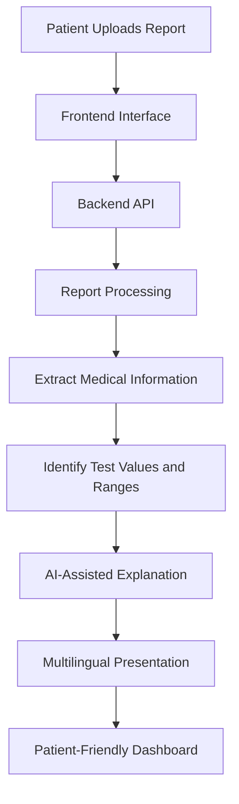
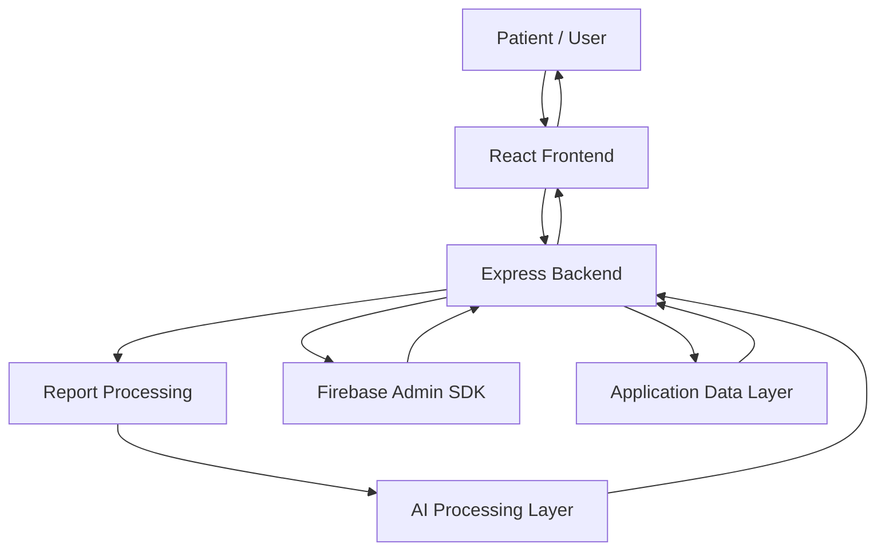

# 🏥 Med-Decoder — AI-Powered Vernacular Healthcare Intelligence Platform

> **"अब मेडिकल रिपोर्ट पढ़ना होगा आसान!"**  
> *Empowering patients across India to understand complex medical reports in simple Hindi, Marathi, and English.*

---

<p align="center">
  <strong>Making Medical Reports Understandable for Everyone.</strong>
</p>

<p align="center">
  
  
  
</p>

<p align="center">
  
  
  
  
  
</p>

---

## 🌐 Live Application

<p align="center">
  <a href="https://med-decoder-i14o.onrender.com/">
    
  </a>
</p>

| Resource | Link |
|---|---|
| 🌐 Live Website | https://med-decoder-i14o.onrender.com/ |
| 🔐 Patient Login | https://med-decoder-i14o.onrender.com/login |
| 💻 GitHub Repository | https://github.com/mohammadjubaid76-collab/Med_Decoder |

**Hosting Platform:** Render

---

## 📌 1. Project Overview

**Med-Decoder** is an AI-powered healthcare report simplification platform designed to make complex medical laboratory reports easier to understand.

Medical reports often contain technical terminology, abbreviations, numerical values, and clinical reference ranges that are difficult for ordinary patients to interpret.

Med-Decoder aims to bridge this healthcare literacy gap by helping patients and caregivers understand laboratory reports through simplified explanations, multilingual support, and structured health information.

The platform focuses on making medical information more accessible in:

- English
- Hindi
- Marathi

### 🎯 Our Mission

To make healthcare information more understandable, accessible, and patient-friendly through AI-powered technology.

---

## 🚨 2. Problem Statement

Medical reports are essential for understanding a person's health condition, but many patients face difficulties interpreting them.

### Major Challenges

1. **Complex Medical Terminology:** Laboratory reports contain technical words that ordinary patients may not understand.
2. **Language Barriers:** Many people are more comfortable understanding health information in their native language.
3. **Reference Range Confusion:** Patients often struggle to understand whether a laboratory value is normal, high, low, or borderline.
4. **Prescription Readability:** Handwritten prescriptions can be difficult to read and interpret.
5. **Limited Health Literacy:** Patients may not know which questions to ask their doctors after receiving their reports.

### 💡 Our Approach

Med-Decoder transforms complex medical information into understandable, structured, and multilingual explanations.

---

## 💡 3. Our Solution

Med-Decoder provides a patient-friendly platform that helps users interpret laboratory reports and understand medical information.

Our solution focuses on:

- Uploading laboratory reports.
- Extracting and organizing report information.
- Explaining medical terms in simpler language.
- Presenting clinical reference-range indicators.
- Providing multilingual explanations.
- Generating suggested questions for doctor consultations.
- Supporting prescription handwriting interpretation.

The objective is to improve patient understanding without replacing professional medical advice.

---

## ✨ 4. Key Features

| Feature | Description |
|---|---|
| 📄 Report Upload | Upload supported laboratory report documents and images. |
| 🧠 AI-Powered Report Decoding | Simplify complex medical information. |
| 🌐 Multilingual Support | English, Hindi, and Marathi explanations. |
| 📊 Clinical Range Indicators | Display Normal, High, Low, and Borderline statuses. |
| 💊 Prescription Decoder | Support interpretation of handwritten prescription information. |
| 🩺 Doctor Question Assistant | Generate three suggested questions for doctor consultations. |
| 📚 Report History | Access previously decoded reports. |
| 🔐 Authentication | Firebase-based authentication and role-aware access. |
| 📱 Responsive Dashboard | Modern healthcare dashboard interface. |
| 🔔 Notifications | User-friendly notification and toast messages. |

---

## 🧠 5. AI Integration & Intelligence Workflow

Med-Decoder uses an AI-oriented report interpretation workflow to simplify medical information.

### Report Processing Workflow



### Intelligence Capabilities

- Medical terminology simplification.
- Interpretation of structured laboratory values.
- Clinical reference-range status presentation.
- Multilingual explanation generation.
- Handwritten prescription interpretation.
- Contextual questions for doctor consultations.

### AI Technology

**Google Gemini API**

The backend is designed to integrate Google's Gemini API for AI-powered processing. A valid server-side Gemini API key is required to enable Gemini functionality.

---

## 🏗️ 6. System Architecture

Med-Decoder follows a modular frontend-backend architecture.



### Architecture Components

| Layer | Technology | Responsibility |
|---|---|---|
| Frontend | React 19 | User interface and dashboard |
| Language | TypeScript | Application logic and type safety |
| Build Tool | Vite | Development and production builds |
| Styling | Tailwind CSS v4 | Responsive design system |
| Backend | Node.js + Express | API handling and server logic |
| AI Integration | Google Gemini API | AI-powered interpretation |
| Authentication / Admin | Firebase | Authentication and server-side administration |
| Deployment | Render | Application hosting |
| Version Control | GitHub | Source code management |

---

## 📁 7. Complete Project Folder Structure

Med-Decoder follows a modular and scalable project structure that separates application pages, reusable components, services, translations, shared state, datasets, and backend configuration.

```text
Med_Decoder/
│
├── index.html
│   └── HTML entry point with Plus Jakarta Sans & JetBrains Mono
│
├── metadata.json
│   └── AI Studio application metadata
│
├── package.json
│   └── Project dependencies and npm scripts
│
├── package-lock.json
│   └── Locked dependency versions
│
├── vite.config.ts
│   └── Vite configuration with Tailwind CSS v4
│
├── server.ts
│   └── Node.js and Express backend server
│
├── .env.example
│   └── Environment variable template
│
├── .gitignore
│   └── Git ignored files and directories
│
├── README.md
│   └── Project documentation
│
├── firebase-applet-config.json
│   └── Firebase application configuration
│
├── firestore.rules
│   └── Firestore security rules
│
├── scripts/
│   └── set-admin.ts
│       └── Firebase admin role configuration script
│
├── public/
│   └── assets/
│       └── Static application assets
│
├── data/
│   └── lab_report_interpretation_sft
---
8. User Workflow
1. Access the Platform: Open the Med-Decoder website.
2. Authentication: Register or log in to the application.
3. Upload Report: Select and upload a supported laboratory report.
4. Report Processing: The backend receives and processes the report.
5. AI Interpretation: The configured AI processing workflow generates simplified explanations.
6. Language Selection: View supported explanations in English, Hindi, or Marathi.
7. Understand Results: Review report values and their displayed clinical statuses.
8. Consult a Doctor: Use suggested questions to prepare for a medical appointment.

🔌 9. Backend API Documentation
The frontend communicates with backend services through REST API endpoints.
Method	Endpoint	Description
POST	/api/reports/upload	Uploads a PDF or image document
POST	/api/reports/decode	Processes a report and generates a simplified interpretation
POST	/api/prescriptions/decode	Processes handwritten prescription information
GET	/api/reports	Retrieves the user's report history
GET	/api/reports/:id	Fetches a specific report by IDBackend Entry Point: server.ts

Health Check:
GET /api/health
Example response:
{
  "status": "ok",
  "firebaseAdminConfigured": true,
  "firebaseProjectId": "med-decoder",
  "geminiConfigured": true
}
The geminiConfigured field indicates whether an API key is configured, not whether a live Gemini request has succeeded.

🚀 10. Live Deployment
Live Application:

https://med-decoder-i14o.onrender.com/login

GitHub Repository:

https://github.com/mohammadjubaid76-collab/Med_Decoder

Hosting Platform: Render

The backend and frontend are served through the deployed Node.js application.

💻 11. Local Installation & Execution
Prerequisites
- Node.js 18 or later
- npm
- Git
- Firebase project
- Google Gemini API key (for Gemini functionality)
Step 1: Clone the repository
git clone https://github.com/mohammadjubaid76-collab/Med_Decoder.git
Step 2: Navigate to the project
cd Med_Decoder
Step 3: Install dependencies
npm install
Step 4: Configure environment variables
Create a .env file in the project root.
GEMINI_API_KEY=your_gemini_api_key

FIREBASE_PROJECT_ID=your_firebase_project_id
GOOGLE_APPLICATION_CREDENTIALS=path/to/firebase-service-account.json

VITE_FIREBASE_API_KEY=your_firebase_api_key
VITE_FIREBASE_AUTH_DOMAIN=your_firebase_auth_domain
VITE_FIREBASE_PROJECT_ID=your_firebase_project_id
VITE_FIREBASE_STORAGE_BUCKET=your_firebase_storage_bucket
VITE_FIREBASE_MESSAGING_SENDER_ID=your_sender_id
VITE_FIREBASE_APP_ID=your_firebase_app_id
VITE_FIREBASE_MEASUREMENT_ID=your_measurement_id
Security Note: Never upload .env or Firebase service-account JSON files to GitHub. Keep private credentials on the server.
Step 5: Start the development server
npm run dev
Step 6: Build for production
npm run build
Step 7: Start the production server
npm run start

🔐 12. Security & Privacy
Med-Decoder is designed with attention to the sensitive nature of healthcare information.

Security considerations include:
- Firebase-based authentication.
- Firebase Admin SDK for server-side administrative operations.
- Server-side storage of private API credentials.
- Environment-based configuration.
- Git-based exclusion of sensitive local files.
- Educational healthcare disclaimers.
Important: Actual data protection, storage retention, access-control policies, and regulatory compliance must be validated before production healthcare use.

🌍 13. Social Impact
Med-Decoder aims to contribute to more accessible healthcare information.
Expected Impact
- Improves understanding of laboratory reports.
- Reduces confusion caused by complex medical terminology.
- Supports people who prefer regional languages.
- Helps patients prepare meaningful questions for doctors.
- Encourages better healthcare awareness and digital health literacy.
Our Vision
A future where every individual can understand their medical information, regardless of technical knowledge or language preference.

🔮 14. Future Scope
Potential future improvements include:
- Additional Indian regional languages.
- Improved OCR for low-quality and scanned reports.
- Enhanced prescription handwriting recognition.
- Integration with more laboratory report formats.
- Secure patient report management.
- More advanced AI-assisted health education.
- Accessibility improvements for elderly users.
- Additional healthcare integrations, subject to appropriate privacy and security safeguards.

👥 15. Team Sophomore
Hackathon: Build The AI For YOU

Team Name: Sophomore
Role	Team Member
🏆 Team Leader	Mohammad Jubaid
👨‍💻 Team Member	Nagesh NarwariyaOur Team's Objective
To develop practical AI-powered solutions that solve meaningful real-world problems through innovation, technology, and teamwork.

⚠️ 16. Medical Disclaimer
Med-Decoder is an educational healthcare information platform.

It is not a substitute for professional medical diagnosis, treatment, or clinical decision-making.

AI-generated explanations may contain inaccuracies. Users should always consult qualified healthcare professionals before making medical decisions.

Do not independently start, stop, or change medication based on the platform's output.

❤️ 17. Acknowledgements
We thank the organizers of Build The AI For YOU for providing an opportunity to develop and present innovative AI-powered solutions.

We also acknowledge the open-source technologies and developer tools that support this project.

<p align="center">
  <strong>Built with ❤️ by Team Sophomore</strong>
  <br/>
  <strong>Med-Decoder | AI for Accessible Healthcare</strong>
</p>


Show less

## ⚖️ Safety & Medical Disclaimer

> **Med-Decoder is an educational health-literacy tool.** It does not provide medical diagnosis, treatment recommendations, or dosage instructions. Always consult a qualified healthcare professional before taking any clinical action.
